# Wave 10: preset parts, status sets, lineage (tickets 25-29)

> Implement, review and merge tickets 25-29 of wave 10 on main: status sets per stock kind with transition rules and in-stock views (spec 4), lineage: true + tm lineage, molbio split into parts (molbio 2-to-3), cellbio and angenet bundles. Done when 25-29 are merged, the full suite is green, tm init works for molbio/cellbio/angenet/[molbio,cellbio] and each passes tm check.

**进度** 12/13 块（92%） · 状态 `active` · 更新于 2026-10-29 02:10

**参与方** lead(agent) · Maxim(human) · w25(agent) · w26(agent) · w27(agent) · w28(agent) · w29(agent) · 本人(human)

## 现在该谁动（NOW / NEXT）

- `T-006#B-003` **close git-bug 0a9acec and ask about zsqlab10** — 待批准 · @maxim

## 图

```mermaid
flowchart LR
  T-001_B-001["B-001 implement ticket 25 in worktree w25"]
  T-001_B-002["B-002 review and merge ticket 25"]
  T-002_B-001["B-001 implement ticket 26 in worktree w26"]
  T-002_B-002["B-002 review and merge ticket 26"]
  T-003_B-001["B-001 implement ticket 27 in worktree w27"]
  T-003_B-002["B-002 review and merge ticket 27"]
  T-004_B-001["B-001 implement ticket 28 in worktree w28"]
  T-004_B-002["B-002 review and merge ticket 28"]
  T-005_B-001["B-001 implement ticket 29 in worktree w29"]
  T-005_B-002["B-002 review and merge ticket 29"]
  T-006_B-001["B-001 wave 10 acceptance on main"]
  T-006_B-002["B-002 release 0.3.0 and wave 10 handover"]
  T-006_B-003["B-003 close git-bug 0a9acec and ask about zsqlab10"]
  T-001_B-001 --> T-001_B-002
  T-002_B-001 --> T-002_B-002
  T-001_B-002 --> T-003_B-001
  T-002_B-002 --> T-003_B-001
  T-003_B-001 --> T-003_B-002
  T-003_B-002 --> T-004_B-001
  T-004_B-001 --> T-004_B-002
  T-004_B-002 --> T-005_B-001
  T-005_B-001 --> T-005_B-002
  T-005_B-002 --> T-006_B-001
  T-006_B-001 --> T-006_B-002
  T-006_B-002 --> T-006_B-003
  classDef done stroke-width:1px;
  class T-001_B-001,T-001_B-002,T-002_B-001,T-002_B-002,T-003_B-001,T-003_B-002,T-004_B-001,T-004_B-002,T-005_B-001,T-005_B-002,T-006_B-001,T-006_B-002 done;
  classDef blocked stroke-width:1px;
  class T-006_B-003 blocked;
```



## 任务

### T-001 25 status sets, transition rules, in-stock views (spec 4) — 已完成
@w25
- [x] `T-001#B-001` **implement ticket 25 in worktree w25** _impl_ — 已完成 @w25
    - 做什么：Read docs/tickets/25-status-sets-transitions.md and docs/preset-parts.md section 4. Work only in the worktree .dsh/gitworktree/w25 (branch wave10/t25, own .venv). Real dolt, no mocks, no commit, leave the tree dirty. Do not touch real ledgers. Report what you chose wherever the ticket leaves a choice.

```bash
cd .dsh/gitworktree/w25 && uv sync -q && .venv/bin/python -m pytest -q -n 4
```
    - 判据：Every item of ticket 25 Verify passes: status-set load errors; tube stored->consumed allow, consumed->stored refuse, --force --note allow with forced=TRUE, --force without --note usage error; creation as consumed works; a hand-written illegal status event is FAIL in tm check; v_stock_<kind> active/depleted/empty and counts as specified; spec/3-to-4 on a spec-3 fixture drops the key, adds forced, tm check passes; custom list refuses writing nothing.
    - 产物：`.dsh/gitworktree/w25 @ 6faa557 + merge 21deeb5`
    - run 2026-10-28 15:37 w25 pending→running Dispatched to teammate w25 in worktree .dsh/gitworktree/w25 (branch wave10/t25, from main 3831fb2).
    - run 2026-10-28 22:07 w25 running→done Report: spec 4 (status sets, transitions with --force/--note, in-stock views, 3-to-4 + base/library steps), full suite 767 passed in worktree. Accepted decisions: molbio version stays 2 (ticket 27 owns molbio/2-to-3); per-status counts/total_quantity dropped from v_stock_status (design says views show in-stock state); migration steps place preset copies before opening.
- [x] `T-001#B-002` **review and merge ticket 25** _review_ — 已完成 @lead
    - 做什么：Lead: review the worktree diff against the ticket and the design doc, run the full suite in the worktree, check no real ledger was touched, then commit on wave10/t25 and merge into main with the wave 9 style merge commit. Record review findings as a note.

```bash
git -C .dsh/gitworktree/w25 diff main --stat
```
    - 判据：Diff reviewed line by line; full suite green in the worktree; no real ledger touched; branch committed and merged to main; plans/ updated.
    - 依赖：T-001#B-001
    - 产物：`main 6552b9b`
    - run 2026-10-28 22:07 lead pending→running Merged main into wave10/t25 (docs/spec split, template harness, molbio-1 fixture); ported spec text to docs/spec/*; legacy-statuses read path and spec-4-only test gating for the migration runner; full suite running.
    - run 2026-10-28 22:13 lead running→done Merged after full suite 788 passed / 1 skipped (drift-guard rebuild skip, documented). Docs ported to docs/spec/*; legacy-statuses read path and spec-4 test gating added.

### T-002 26 lineage true on ref fields + tm lineage — 已完成
@w26
- [x] `T-002#B-001` **implement ticket 26 in worktree w26** _impl_ — 已完成 @w26
    - 做什么：Read docs/tickets/26-tm-lineage.md and docs/preset-parts.md section 5. Work only in the worktree .dsh/gitworktree/w26 (branch wave10/t26, own .venv). Real dolt, no mocks, no commit, leave the tree dirty. Read whatever count columns v_stock_<kind> has through one small accessor so ticket 25 only changes the accessor. Record where the lineage flags were added.

```bash
cd .dsh/gitworktree/w26 && uv sync -q && .venv/bin/python -m pytest -q -n 4
```
    - 判据：Every item of ticket 26 Verify passes: construct->plasmid->bacterial stock->child stock->source aliquot chain and cell_line parental line show in tm lineage; --up/--down/--depth trim; diamond prints see-above once and JSON lists the node once; --format dot parses with dot -Tsvg if installed; lineage: true on a string field fails to load; no SPEC_VERSION bump.
    - 产物：`.dsh/gitworktree/w26 @ 35a3b5c (branch wave10/t26)`
    - run 2026-10-28 15:37 w26 pending→running Dispatched to teammate w26 in worktree .dsh/gitworktree/w26 (branch wave10/t26, from main 3831fb2).
    - run 2026-10-28 16:27 w26 running→done Report received: ops/lineage.py 622 lines + cli/lineage.py + 21 tests; 768-pass full run in the worktree; accessor STOCK_COUNT_COLUMNS is the only column-name reader.
- [x] `T-002#B-002` **review and merge ticket 26** _review_ — 已完成 @lead
    - 做什么：Lead: review the worktree diff against the ticket and design, run the full suite, check the lineage accessor is the single place that reads stock counts, then commit on wave10/t26 and merge into main. Record findings as a note.

```bash
git -C .dsh/gitworktree/w26 diff main --stat
```
    - 判据：Diff reviewed; full suite green; accessor is the only count reader; no real ledger touched; branch committed and merged to main.
    - 依赖：T-002#B-001
    - 产物：`main a635762 (merge of wave10/t26) + docs port to docs/spec`
    - run 2026-10-28 16:27 lead pending→running Reviewing diff; committed 35a3b5c, merged main, re-running full suite on the branch before merging to main.
    - run 2026-10-28 16:44 lead running→done Reviewed: attribute is ref-only + entity/stock-only, fingerprint only when set, accessor single-reader, cycle guard, JSON/text/dot shapes, no real ledger touched. Ported the spec text onto the new docs/spec split (02/05/06) after another session's docs reorg; targeted suite 208 passed. Full suite on main started.

### T-003 27 split molbio into parts (molbio 2 to 3) — 已完成
@w27
- [x] `T-003#B-001` **implement ticket 27 in worktree w27** _impl_ — 已完成 @w27
    - 做什么：Read docs/tickets/27-molbio-into-parts.md and docs/preset-parts.md section 2. Work only in the worktree .dsh/gitworktree/w27 (branch wave10/t27, own .venv). Decide and record: which part includes which for plasmid.construct -> protein_construct, and where sequence_fields lives. migration/presets/molbio/2-to-3 must add oligo tables, replace preset copies, bump preset_versions. Check the zsqlab10 path only on a copy (spec/3-to-4 then molbio 2-to-3). No commit, leave the tree dirty.

```bash
cd .dsh/gitworktree/w27 && uv sync -q && .venv/bin/python -m pytest -q -n 4
```
    - 判据：Ticket 27 Verify passes: tm init --preset molbio gives the same kinds as v2 plus entity_oligo and stock_oligo_stock, tm check clean, preset_versions lists molbio 3 plus each part; [molbio, cellbio] loads once ticket 28 exists (until then the test-only preset with cell_culture); a molbio-v2 fixture with data migrates to v3 keeping every row and tm check clean.
    - 依赖：T-001#B-002
    - 依赖：T-002#B-002
    - 产物：`.dsh/gitworktree/w27 @ a0c7480`
    - run 2026-10-28 22:15 w27 pending→running Dispatched: parts nucleic_acids/bacteria/proteins/cell_culture, molbio v3 bundle, base 2->3 (incubator), molbio 2->3 + presets/README; docs in the split spec tree.
    - run 2026-10-28 23:30 w27 running→done Parts nucleic_acids/bacteria/proteins/cell_culture, molbio v3 bundle, base v3 incubator, molbio 2->3 + base 2->3, frozen v1->2 snapshots, preset_versions_extra/vendor_preset_files in the runner; 802 passed 1 skipped.
- [x] `T-003#B-002` **review and merge ticket 27** _review_ — 已完成 @lead
    - 做什么：Lead: review diff against ticket and design, verify no table or kind rename slipped in, run the full suite, then commit on wave10/t27 and merge into main. Record the two open choices the agent made and whether they match the preferred options.

```bash
git -C .dsh/gitworktree/w27 diff main --stat
```
    - 判据：Diff reviewed; no unintended renames; full suite green; open choices recorded; branch committed and merged to main.
    - 依赖：T-003#B-001
    - 产物：`main 902f6d0`
    - run 2026-10-28 23:30 lead pending→running Reviewed the step design, frozen snapshots byte-identical to 6faa557/6552b9b, runner additions validated; merged to main 902f6d0, full suite running.
    - run 2026-10-28 23:39 lead running→done Reviewed; merged; full suite on main 802 passed / 1 skipped (518s).

### T-004 28 cellbio bundle (immuno, viral_vectors, biosamples) — 已完成
@w28
- [x] `T-004#B-001` **implement ticket 28 in worktree w28** _impl_ — 已完成 @w28
    - 做什么：Read docs/tickets/28-cellbio-bundle.md and docs/preset-parts.md sections 2 and 2.1. Work only in the worktree .dsh/gitworktree/w28 (branch wave10/t28, own .venv). First check what the loader does with an entity_kinds entry that is not loaded, then take the smallest option, preferring the split cell_biosample/animal_biosample with no core change; record the choice in the part description and presets/README.md. No commit, leave the tree dirty.

```bash
cd .dsh/gitworktree/w28 && uv sync -q && .venv/bin/python -m pytest -q -n 4
```
    - 判据：Ticket 28 Verify passes: tm init --preset cellbio creates the expected tables and passes tm check; tm lineage <virus> shows no payload edge while <cell_line> shows parental; presets [molbio, cellbio] loads with shared parts loaded once and tm check clean; a biosample from a cell vial aliquot appears under it in tm lineage.
    - 依赖：T-003#B-002
    - 产物：`.dsh/gitworktree/w28 @ 9343c49`
    - run 2026-10-28 23:39 w28 pending→running Dispatched to teammate w28 in worktree .dsh/gitworktree/w28 (branch wave10/t28 from main 902f6d0): immuno/viral_vectors/biosamples, cellbio bundle, cell_culture 1->2 with a frozen v1 copy.
    - run 2026-10-29 00:47 w28 running→done immuno/viral_vectors/biosamples parts, cellbio bundle, cell_culture v2 + 1->2 step (frozen copies), option (a) biosamples split; 824 passed 1 skipped.
- [x] `T-004#B-002` **review and merge ticket 28** _review_ — 已完成 @lead
    - 做什么：Lead: review the diff, confirm the entity_kinds choice is the smallest one and is documented, run the full suite, then commit on wave10/t28 and merge into main.

```bash
git -C .dsh/gitworktree/w28 diff main --stat
```
    - 判据：Diff reviewed; entity_kinds choice documented and minimal; full suite green; branch committed and merged to main.
    - 依赖：T-004#B-001
    - 产物：`main f027bd9`
    - run 2026-10-29 00:47 lead pending→done Reviewed: frozen cell_culture copies byte-identical (v1 from 902f6d0, v2 from repo), no core change, loader behaviour for entity_kinds verified, retrofitted base/molbio 2-to-3 steps ship cell_culture-1; merged.

### T-005 29 angenet bundle (drosophila, c_elegans, zebrafish, mouse) — 已完成
@w29
- [x] `T-005#B-001` **implement ticket 29 in worktree w29** _impl_ — 已完成 @w29
    - 做什么：Read docs/tickets/29-angenet-bundle.md and docs/preset-parts.md section 3. Work only in the worktree .dsh/gitworktree/w29 (branch wave10/t29, own .venv). Adapt biosamples to ticket 28's choice. No core change: if one turns out necessary, stop and report instead of adding it. Document the litter recipe with exact tm commands in presets/README.md and skills/tetramark/SKILL.md. No commit, leave the tree dirty.

```bash
cd .dsh/gitworktree/w29 && uv sync -q && .venv/bin/python -m pytest -q -n 4
```
    - 判据：Ticket 29 Verify passes through the CLI: tm init --preset angenet passes tm check; the mouse strain -> cohort -> litter -> genotyping split chain works with dam/sire refs and tm lineage up/down reaches both parents; alive -> euthanized allowed, euthanized -> alive refused without --force; fly cross vial with a virgins aliquot; worm_cryo stored -> thawed then refused; v_stock_mouse_cohort drops aliquots_in_stock as mice are euthanized.
    - 依赖：T-004#B-002
    - 产物：`.dsh/gitworktree/w29 @ 44e294a`
    - run 2026-10-29 00:47 w29 pending→running Dispatched: drosophila/c_elegans/zebrafish/mouse parts (kinds exactly fly_line/worm_strain/fish_line/mouse_strain), angenet bundle with biosamples, cage box kind, litter recipe; docs in presets/README + SKILL + spec 08.
    - run 2026-10-29 01:52 w29 running→done drosophila/c_elegans/zebrafish/mouse parts + angenet v1, no core change, no migration; 844 passed 1 skipped. Choices: non-sex BioManager selects are strings; breeding pair = two cohorts; organism parts carry no rules.
- [x] `T-005#B-002` **review and merge ticket 29** _review_ — 已完成 @lead
    - 做什么：Lead: review the diff, check no core change was needed, run the full suite, then commit on wave10/t29 and merge into main.

```bash
git -C .dsh/gitworktree/w29 diff main --stat
```
    - 判据：Diff reviewed; no core change; full suite green; branch committed and merged to main.
    - 依赖：T-005#B-001
    - 产物：`main 49e168a`
    - run 2026-10-29 01:52 lead pending→done Reviewed the parts/bundle/status sets against design 3, biosamples kind names, lineage refs, cage box; merged to main; final suite running.

### T-006 wave 10 close: acceptance, release, handover — 待批准
@lead
- [x] `T-006#B-001` **wave 10 acceptance on main** _impl_ — 已完成 @lead
    - 做什么：Lead: on main after all five merges, run the full suite, tm init for molbio, cellbio, angenet and [molbio, cellbio] and tm check each; confirm docs/spec/*, README and skills/tetramark/SKILL.md match the shipped behaviour and migration/README explains the preset parts.

```bash
cd /Users/maxim/Repositories/AgentNative/Tetramark && .venv/bin/python -m pytest -q -n 6
```
    - 判据：Full suite green on main; the four tm init combinations pass tm check; docs and skill agree with the code; no leftover temporary files or half-applied migrations in the repo.
    - 依赖：T-005#B-002
    - 产物：`main 844 passed / 1 skipped (725s); acceptance workspace runs for molbio/cellbio/angenet/[molbio,cellbio]`
    - run 2026-10-29 02:10 lead pending→done Acceptance evidence: tm init + tm check + tm schema plan all green — molbio 22 kinds/8 rules/27 checks, cellbio 23/9/28, angenet 30/6/31, molbio+cellbio 26/10/31; every schema plan 'up to date'.
- [x] `T-006#B-002` **release 0.3.0 and wave 10 handover** _impl_ — 已完成 @lead
    - 做什么：Lead: bump the version, write docs/tickets/HANDOVER-wave11.md (or a wave 10 closing note), commit plans/ and the wave, push nothing unless asked.

```bash
git status --short && git log --oneline -3
```
    - 判据：Version bumped and committed with the wave 10 merge; handover names what shipped, the open choices made, and the zsqlab10 follow-up as a proposal only.
    - 依赖：T-006#B-001
    - 产物：`2aee18b chore: release 0.3.0 + docs/records/wave10-delivery.md`
    - run 2026-10-29 02:10 lead pending→done Version bumped (pyproject/__init__/uv.lock), wave 10 delivery record written, tickets index now lists open work only, wave 10 handover retired; smoke tests 64 passed.
- [ ] `T-006#B-003` **close git-bug 0a9acec and ask about zsqlab10** _decision_ — 待批准 @maxim
    - 做什么：Needs the user: close git-bug 0a9acec with a pointer to the release, and decide whether to run spec/3-to-4 plus molbio 2-to-3 on the real zsqlab10 ledger (proposal only until the user agrees).

```bash
git-bug bug show 0a9acec
```
    - 判据：git-bug 0a9acec closed with the release pointer, and the user has answered the zsqlab10 follow-up question.
    - 依赖：T-006#B-002
    - run 2026-10-29 02:10 lead blocked→blocked Waiting on the user: close git-bug 0a9acec with the release pointer, and decide whether to run the zsqlab10 upgrade (spec/3-to-4 -> base/molbio/cell_culture preset steps) after reviewing the delivery record.

## 日志（近 20 条）

- `2026-10-29 01:52` **lead** [summary] Tickets 25-29 all merged on main (49e168a): spec 4 status sets/transitions/in-stock views, tm lineage, molbio parts v3, cellbio v1, angenet v1. Next: acceptance on main, release 0.3.0, wave report, zsqlab10 follow-up proposal to the user.
- `2026-10-29 02:10` **agent** [block] T-001#B-001 改了 做什么
- `2026-10-29 02:10` **agent** [block] T-001#B-002 改了 做什么
- `2026-10-29 02:10` **agent** [block] T-002#B-001 改了 做什么
- `2026-10-29 02:10` **agent** [block] T-002#B-002 改了 做什么
- `2026-10-29 02:10` **agent** [block] T-003#B-001 改了 做什么
- `2026-10-29 02:10` **agent** [block] T-003#B-002 改了 做什么
- `2026-10-29 02:10` **agent** [block] T-004#B-001 改了 做什么
- `2026-10-29 02:10` **agent** [block] T-004#B-002 改了 做什么
- `2026-10-29 02:10` **agent** [block] T-005#B-001 改了 做什么
- `2026-10-29 02:10` **agent** [block] T-005#B-002 改了 做什么
- `2026-10-29 02:10` **agent** [block] T-006#B-001 改了 做什么
- `2026-10-29 02:10` **agent** [block] T-006#B-002 改了 做什么
- `2026-10-29 02:10` **agent** [block] T-006#B-003 改了 做什么
- `2026-10-29 02:10` **agent** [block] T-006#B-001 改了 命令
- `2026-10-29 02:10` **agent** [block] T-006#B-001 改了 做什么
- `2026-10-29 02:10` **agent** [status] T-006#B-001: pending → done（Acceptance evidence: tm init + tm check + tm schema plan all green — molbio 22 kinds/8 rules/27 checks, cellbio 23/9/28, angenet 30/6/31, molbio+cellbio 26/10/31; every schema plan 'up to date'.）
- `2026-10-29 02:10` **agent** [status] T-006#B-002: pending → done（Version bumped (pyproject/__init__/uv.lock), wave 10 delivery record written, tickets index now lists open work only, wave 10 handover retired; smoke tests 64 passed.）
- `2026-10-29 02:10` **agent** [status] T-006#B-003: blocked → blocked（Waiting on the user: close git-bug 0a9acec with the release pointer, and decide whether to run the zsqlab10 upgrade (spec/3-to-4 -> base/molbio/cell_culture preset steps) after reviewing the delivery record.）
- `2026-10-29 02:10` **lead** [summary] Wave 10 delivered. plan checks: loomerto-check-commands APPROVED (13/13 blocks have a runnable command), loomerto-check-temps no temp artifacts. Release 0.3.0 at 2aee18b. Delivery record docs/records/wave10-delivery.md. Only T-006#B-003 remains blocked on the user (git-bug close + zsqlab10 go-ahead).

---
plan.json 是唯一真相；本文件与 plan.html / plan.canvas 由 `plan.py render wave10` 生成。
