# Wave 10: preset parts, status sets, lineage (tickets 25-29)

> Implement, review and merge tickets 25-29 of wave 10 on main: status sets per stock kind with transition rules and in-stock views (spec 4), lineage: true + tm lineage, molbio split into parts (molbio 2-to-3), cellbio and angenet bundles. Done when 25-29 are merged, the full suite is green, tm init works for molbio/cellbio/angenet/[molbio,cellbio] and each passes tm check.

**进度** 0/13 块（0%） · 状态 `active` · 更新于 2026-10-28 15:37

**参与方** lead(agent) · Maxim(human) · w25(agent) · w26(agent) · w27(agent) · w28(agent) · w29(agent) · 本人(human)

## 现在该谁动（NOW / NEXT）

- `T-006#B-003` **close git-bug 0a9acec and ask about zsqlab10** — 待批准 · @maxim
- `T-001#B-001` **implement ticket 25 in worktree w25** — 进行中 · @w25 · 在做 @w25
- `T-002#B-001` **implement ticket 26 in worktree w26** — 进行中 · @w26 · 在做 @w26

## 图

```mermaid
flowchart LR
  T-001_B-001["B-001 implement ticket 25 in worktree w25"]
  T-001_B-002["B-002 review and merge ticket 25"]
  T-002_B-001["B-001 implement ticket 26 in worktree w26"]
  T-002_B-002["B-002 review and merge ticket 26"]
  T-003_B-001["B-001 implement ticket 27 in worktree w27"]
  T-003_B-002["B-002 review and merge ticket 27"]
  T-004_B-001["B-001 implement ticket 28 in worktree w28"]
  T-004_B-002["B-002 review and merge ticket 28"]
  T-005_B-001["B-001 implement ticket 29 in worktree w29"]
  T-005_B-002["B-002 review and merge ticket 29"]
  T-006_B-001["B-001 wave 10 acceptance on main"]
  T-006_B-002["B-002 release 0.3.0 and wave 10 handover"]
  T-006_B-003["B-003 close git-bug 0a9acec and ask about zsqlab10"]
  T-001_B-001 --> T-001_B-002
  T-002_B-001 --> T-002_B-002
  T-001_B-002 --> T-003_B-001
  T-002_B-002 --> T-003_B-001
  T-003_B-001 --> T-003_B-002
  T-003_B-002 --> T-004_B-001
  T-004_B-001 --> T-004_B-002
  T-004_B-002 --> T-005_B-001
  T-005_B-001 --> T-005_B-002
  T-005_B-002 --> T-006_B-001
  T-006_B-001 --> T-006_B-002
  T-006_B-002 --> T-006_B-003
  classDef running stroke-width:1px;
  class T-001_B-001,T-002_B-001 running;
  classDef waiting stroke-width:1px;
  class T-001_B-002,T-002_B-002,T-003_B-001,T-003_B-002,T-004_B-001,T-004_B-002,T-005_B-001,T-005_B-002,T-006_B-001,T-006_B-002 waiting;
  classDef blocked stroke-width:1px;
  class T-006_B-003 blocked;
```

## 任务

### T-001 25 status sets, transition rules, in-stock views (spec 4) — 进行中
@w25
- [ ] `T-001#B-001` **implement ticket 25 in worktree w25** _impl_ — 进行中 @w25
    - 做什么：Read docs/tickets/25-status-sets-transitions.md and docs/preset-parts.md section 4. Work only in the worktree .dsh/gitworktree/w25 (branch wave10/t25, own .venv). Real dolt, no mocks, no commit, leave the tree dirty. Do not touch real ledgers. Report what you chose wherever the ticket leaves a choice.
    - 判据：Every item of ticket 25 Verify passes: status-set load errors; tube stored->consumed allow, consumed->stored refuse, --force --note allow with forced=TRUE, --force without --note usage error; creation as consumed works; a hand-written illegal status event is FAIL in tm check; v_stock_<kind> active/depleted/empty and counts as specified; spec/3-to-4 on a spec-3 fixture drops the key, adds forced, tm check passes; custom list refuses writing nothing.
    - 在做：@w25
    - run 2026-10-28 15:37 w25 pending→running Dispatched to teammate w25 in worktree .dsh/gitworktree/w25 (branch wave10/t25, from main 3831fb2).
- [ ] `T-001#B-002` **review and merge ticket 25** _review_ — 等前置 @lead
    - 做什么：Lead: review the worktree diff against the ticket and the design doc, run the full suite in the worktree, check no real ledger was touched, then commit on wave10/t25 and merge into main with the wave 9 style merge commit. Record review findings as a note.
    - 判据：Diff reviewed line by line; full suite green in the worktree; no real ledger touched; branch committed and merged to main; plans/ updated.
    - 依赖：T-001#B-001

### T-002 26 lineage true on ref fields + tm lineage — 进行中
@w26
- [ ] `T-002#B-001` **implement ticket 26 in worktree w26** _impl_ — 进行中 @w26
    - 做什么：Read docs/tickets/26-tm-lineage.md and docs/preset-parts.md section 5. Work only in the worktree .dsh/gitworktree/w26 (branch wave10/t26, own .venv). Real dolt, no mocks, no commit, leave the tree dirty. Read whatever count columns v_stock_<kind> has through one small accessor so ticket 25 only changes the accessor. Record where the lineage flags were added.
    - 判据：Every item of ticket 26 Verify passes: construct->plasmid->bacterial stock->child stock->source aliquot chain and cell_line parental line show in tm lineage; --up/--down/--depth trim; diamond prints see-above once and JSON lists the node once; --format dot parses with dot -Tsvg if installed; lineage: true on a string field fails to load; no SPEC_VERSION bump.
    - 在做：@w26
    - run 2026-10-28 15:37 w26 pending→running Dispatched to teammate w26 in worktree .dsh/gitworktree/w26 (branch wave10/t26, from main 3831fb2).
- [ ] `T-002#B-002` **review and merge ticket 26** _review_ — 等前置 @lead
    - 做什么：Lead: review the worktree diff against the ticket and design, run the full suite, check the lineage accessor is the single place that reads stock counts, then commit on wave10/t26 and merge into main. Record findings as a note.
    - 判据：Diff reviewed; full suite green; accessor is the only count reader; no real ledger touched; branch committed and merged to main.
    - 依赖：T-002#B-001

### T-003 27 split molbio into parts (molbio 2 to 3) — 待排
@w27
- [ ] `T-003#B-001` **implement ticket 27 in worktree w27** _impl_ — 等前置 @w27
    - 做什么：Read docs/tickets/27-molbio-into-parts.md and docs/preset-parts.md section 2. Work only in the worktree .dsh/gitworktree/w27 (branch wave10/t27, own .venv). Decide and record: which part includes which for plasmid.construct -> protein_construct, and where sequence_fields lives. migration/presets/molbio/2-to-3 must add oligo tables, replace preset copies, bump preset_versions. Check the zsqlab10 path only on a copy (spec/3-to-4 then molbio 2-to-3). No commit, leave the tree dirty.
    - 判据：Ticket 27 Verify passes: tm init --preset molbio gives the same kinds as v2 plus entity_oligo and stock_oligo_stock, tm check clean, preset_versions lists molbio 3 plus each part; [molbio, cellbio] loads once ticket 28 exists (until then the test-only preset with cell_culture); a molbio-v2 fixture with data migrates to v3 keeping every row and tm check clean.
    - 依赖：T-001#B-002
    - 依赖：T-002#B-002
- [ ] `T-003#B-002` **review and merge ticket 27** _review_ — 等前置 @lead
    - 做什么：Lead: review diff against ticket and design, verify no table or kind rename slipped in, run the full suite, then commit on wave10/t27 and merge into main. Record the two open choices the agent made and whether they match the preferred options.
    - 判据：Diff reviewed; no unintended renames; full suite green; open choices recorded; branch committed and merged to main.
    - 依赖：T-003#B-001

### T-004 28 cellbio bundle (immuno, viral_vectors, biosamples) — 待排
@w28
- [ ] `T-004#B-001` **implement ticket 28 in worktree w28** _impl_ — 等前置 @w28
    - 做什么：Read docs/tickets/28-cellbio-bundle.md and docs/preset-parts.md sections 2 and 2.1. Work only in the worktree .dsh/gitworktree/w28 (branch wave10/t28, own .venv). First check what the loader does with an entity_kinds entry that is not loaded, then take the smallest option, preferring the split cell_biosample/animal_biosample with no core change; record the choice in the part description and presets/README.md. No commit, leave the tree dirty.
    - 判据：Ticket 28 Verify passes: tm init --preset cellbio creates the expected tables and passes tm check; tm lineage <virus> shows no payload edge while <cell_line> shows parental; presets [molbio, cellbio] loads with shared parts loaded once and tm check clean; a biosample from a cell vial aliquot appears under it in tm lineage.
    - 依赖：T-003#B-002
- [ ] `T-004#B-002` **review and merge ticket 28** _review_ — 等前置 @lead
    - 做什么：Lead: review the diff, confirm the entity_kinds choice is the smallest one and is documented, run the full suite, then commit on wave10/t28 and merge into main.
    - 判据：Diff reviewed; entity_kinds choice documented and minimal; full suite green; branch committed and merged to main.
    - 依赖：T-004#B-001

### T-005 29 angenet bundle (drosophila, c_elegans, zebrafish, mouse) — 待排
@w29
- [ ] `T-005#B-001` **implement ticket 29 in worktree w29** _impl_ — 等前置 @w29
    - 做什么：Read docs/tickets/29-angenet-bundle.md and docs/preset-parts.md section 3. Work only in the worktree .dsh/gitworktree/w29 (branch wave10/t29, own .venv). Adapt biosamples to ticket 28's choice. No core change: if one turns out necessary, stop and report instead of adding it. Document the litter recipe with exact tm commands in presets/README.md and skills/tetramark/SKILL.md. No commit, leave the tree dirty.
    - 判据：Ticket 29 Verify passes through the CLI: tm init --preset angenet passes tm check; the mouse strain -> cohort -> litter -> genotyping split chain works with dam/sire refs and tm lineage up/down reaches both parents; alive -> euthanized allowed, euthanized -> alive refused without --force; fly cross vial with a virgins aliquot; worm_cryo stored -> thawed then refused; v_stock_mouse_cohort drops aliquots_in_stock as mice are euthanized.
    - 依赖：T-004#B-002
- [ ] `T-005#B-002` **review and merge ticket 29** _review_ — 等前置 @lead
    - 做什么：Lead: review the diff, check no core change was needed, run the full suite, then commit on wave10/t29 and merge into main.
    - 判据：Diff reviewed; no core change; full suite green; branch committed and merged to main.
    - 依赖：T-005#B-001

### T-006 wave 10 close: acceptance, release, handover — 待排
@lead
- [ ] `T-006#B-001` **wave 10 acceptance on main** _impl_ — 等前置 @lead
    - 做什么：Lead: on main after all five merges, run the full suite, tm init for molbio, cellbio, angenet and [molbio, cellbio] and tm check each; confirm docs/spec.md, README and skills/tetramark/SKILL.md match the shipped behaviour and migration/README explains the preset parts.
    - 判据：Full suite green on main; the four tm init combinations pass tm check; docs and skill agree with the code; no leftover temporary files or half-applied migrations in the repo.
    - 依赖：T-005#B-002
- [ ] `T-006#B-002` **release 0.3.0 and wave 10 handover** _impl_ — 等前置 @lead
    - 做什么：Lead: bump the version, write docs/tickets/HANDOVER-wave11.md (or a wave 10 closing note), commit plans/ and the wave, push nothing unless asked.
    - 判据：Version bumped and committed with the wave 10 merge; handover names what shipped, the open choices made, and the zsqlab10 follow-up as a proposal only.
    - 依赖：T-006#B-001
- [ ] `T-006#B-003` **close git-bug 0a9acec and ask about zsqlab10** _decision_ — 待批准 @maxim
    - 做什么：Needs the user: close git-bug 0a9acec with a pointer to the release, and decide whether to run spec/3-to-4 plus molbio 2-to-3 on the real zsqlab10 ledger (proposal only until the user agrees).
    - 判据：git-bug 0a9acec closed with the release pointer, and the user has answered the zsqlab10 follow-up question.
    - 依赖：T-006#B-002

## 日志（近 20 条）

- `2026-10-28 15:33` **agent** [block] 新增块 T-006#B-001「wave 10 acceptance on main」
- `2026-10-28 15:33` **agent** [block] 新增块 T-006#B-002「release 0.3.0 and wave 10 handover」
- `2026-10-28 15:33` **agent** [block] 新增块 T-006#B-003「close git-bug 0a9acec and ask about zsqlab10」
- `2026-10-28 15:33` **agent** [block] T-001#B-001 改了 命令
- `2026-10-28 15:33` **agent** [block] T-002#B-001 改了 命令
- `2026-10-28 15:33` **agent** [block] T-003#B-001 改了 命令
- `2026-10-28 15:33` **agent** [block] T-004#B-001 改了 命令
- `2026-10-28 15:33` **agent** [block] T-005#B-001 改了 命令
- `2026-10-28 15:33` **agent** [block] T-001#B-002 改了 命令
- `2026-10-28 15:33` **agent** [block] T-002#B-002 改了 命令
- `2026-10-28 15:33` **agent** [block] T-003#B-002 改了 命令
- `2026-10-28 15:33` **agent** [block] T-004#B-002 改了 命令
- `2026-10-28 15:33` **agent** [block] T-005#B-002 改了 命令
- `2026-10-28 15:33` **agent** [block] T-006#B-001 改了 命令
- `2026-10-28 15:33` **agent** [block] T-006#B-002 改了 命令
- `2026-10-28 15:33` **agent** [block] T-006#B-003 改了 命令
- `2026-10-28 15:34` **agent** [block] T-006#B-003 改了 命令
- `2026-10-28 15:37` **agent** [status] T-001#B-001: pending → running（Dispatched to teammate w25 in worktree .dsh/gitworktree/w25 (branch wave10/t25, from main 3831fb2).）
- `2026-10-28 15:37` **agent** [status] T-002#B-001: pending → running（Dispatched to teammate w26 in worktree .dsh/gitworktree/w26 (branch wave10/t26, from main 3831fb2).）
- `2026-10-28 15:37` **lead** [summary] Lead took over wave 10 at 15:30. Evidence: main = 3831fb2 (wave 9 merged, v0.2.0); docs/preset-parts.md + tickets 25-29 committed; no implementation. Worktrees w25/w26 created from main and venvs synced; tickets 25 and 26 dispatched in parallel. Another DSH session is still committing the last wave-9 docs in the parent checkout; its run was left alone.

---
plan.json 是唯一真相；本文件与 plan.html / plan.canvas 由 `plan.py render wave10` 生成。
