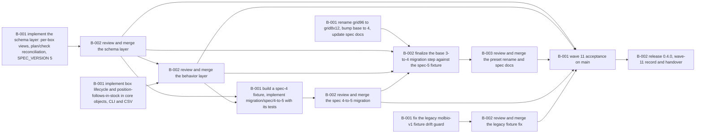

# Wave 11: one view per box (spec 5, ticket 30)

> Implement, review and merge ticket 30 of wave 11 on main: one generated view per existing box replaces v_box_<kind> (grid pivot / named slots / slotless occupant), grid boxes hold tubes only, grid96 becomes grid8x12 (base 3->4), an aliquot has a position exactly when in stock, box names must be view-safe, tm schema plan/apply and tm check reconcile per-box views, migration/spec/4-to-5 plus migration/presets/base/3-to-4. Done when every acceptance bullet of docs/issues/002-box-views.md passes, both migration steps run on fixtures, the full suite is green on main, 0.4.0 is tagged and a wave-11 delivery record exists.

**进度** 8/13 块（62%） · 状态 `active` · 更新于 2026-10-29 18:03

**参与方** lead(agent) · Maxim(human) · w31(agent) · w32(agent) · w33(agent) · w34(agent) · w35(agent) · 本人(human)

## 现在该谁动（NOW / NEXT）

- `T-003#B-001` **rename grid96 to grid8x12, bump base to 4, update spec docs** — 待评审 · @w33 · 在做 @w33

## 图

## 任务

### T-001 31 schema layer: per-box views, plan/check reconciliation, SPEC_VERSION 5 — 已完成
@w31
- [x] `T-001#B-001` **implement the schema layer: per-box views, plan/check reconciliation, SPEC_VERSION 5** _impl_ — 已完成 @w31
    - 做什么：Read docs/issues/002-box-views.md first: every decision there is settled, do not re-open it. Read plans/wave11/PLAN.md. Work only in your own worktree .dsh/gitworktree/w31 (branch wave11/t31): create it from main with the worktree tool, then run uv sync -q so it gets its own .venv. Real dolt, no mocks. Never touch a real ledger. Do not commit and do not merge: leave the tree dirty and report. Iterate with uv run pytest -q -m fast; run the full suite before reporting. Stay inside your write scope; if another workstream must change a file, report it instead of editing it.

Scope (only these files): src/tetramark/schema/ddl.py, src/tetramark/schema/diff.py, src/tetramark/schema/model.py, src/tetramark/schema/tests_gen.py, src/tetramark/cli/check.py, src/tetramark/cli/schema.py, plus tests for this layer (test_ddl.py, test_schema_diff.py, test_schema_model.py, test_validation.py and new tests). Do NOT edit core/objects.py, cli/box.py, cli/aliquot.py, ops/io_csv.py, presets/, migration/ or docs/ - other workstreams own those.

The interface you owe the rest of the wave (the Lead fixes it; w32 and w34 code against it):
1. ddl.view_statements(schema) emits only the core views (v_box_slots, v_aliquot_location, v_stock_status) plus v_entity_<kind> and v_stock_<kind>. Box kinds get no v_box_<kind> view any more.
2. New ddl.box_view_name(box_name) -> v_box_ + name, and ddl.box_view_statements(schema, boxes) -> list[Statement] where boxes are mappings with at least the keys id, name, kind; each Statement.object is view and its name is the full v_box_<name>. A helper for one box may exist too.
3. View shapes exactly as the issue states. grid geometry: a pivot, first column named row, then one column per column label in geometry order; one row per row label in geometry order, empty rows included; a cell is GROUP_CONCAT of the aliquot ids in that box slot ordered by id with separator comma and NULL when empty; no other columns. named geometry: columns slot and occupants; one row per slot in geometry order, empty slots included with occupants NULL; occupants are aliquot ids or child box names joined with comma. slotless geometry: one column occupant, one row per direct occupant (aliquot id or child box name) sorted ascending, zero rows when the box is empty. Only direct contents of that box are listed.
4. model.py: SPEC_VERSION = 5; new box_name_problem(box_name, existing_names) -> str | None returning a refusal message when (a) v_box_<name> would equal a core view name (compare case-insensitively; today that is the name slots, and any future core v_box_* view), (b) the name is longer than 58 characters, or (c) it differs only in case from an existing box name. w32 calls this from box add and CSV import.
5. diff.py: build_plan reconciles per-box views from the live box rows in addition to the schema-derived views (create missing, drop orphaned, replace changed); when the box table does not exist yet there are no box views. _managed_view must treat any v_box_* that is not a core view as managed (box names are not lowercase and can contain a dash). A live box row whose kind the schema does not know is a LedgerError naming the box. renames.yaml / RenameMap support must keep working, because w33 and w34 feed a base rename through build_plan.
6. tm check: report per-box views that are missing, orphaned or out of date as a failing (blocking) result; dropping a per-box view by hand must make tm check fail and tm schema apply recreate it.
7. tests_gen.py: remove the old core_in_stock_aliquot_slot rule and add: position-follows-in-stock in both directions (a not-in-stock aliquot must have box_id AND slot NULL; an in-stock aliquot must have box_id NOT NULL, and slot NOT NULL when its box is slotted), grid boxes hold no child boxes, and a box-name validity rule with the same three conditions as box_name_problem (listing the offending boxes). Keep the generated tests deterministic and grouped; update any test that counts dolt_tests.
8. Tests for the view SQL shapes (see Acceptance in the issue), plan reconciliation, check drift, the name helper and SPEC_VERSION 5; update existing expectations that mention v_box_<kind> or old test counts.

Done when: fast lane green; targeted suites (test_ddl, test_schema_diff, test_schema_model, test_validation) green; full suite green in the worktree; the view-shape and reconciliation acceptance bullets of docs/issues/002-box-views.md can be demonstrated from a scratch ledger (paste commands and outputs in your report). Report: files changed, the interface exactly as delivered (signatures), decisions you had to make, full suite count, and anything that belongs to another workstream.
    - 判据：view_statements emits no box kind views; box_view_statements produces the grid pivot, named and slotless shapes with the exact columns/ordering/empty rows stated in docs/issues/002-box-views.md; SPEC_VERSION is 5; box_name_problem refuses core-name collision, 59-char names and case-only duplicates; build_plan creates/drops/replaces per-box views from live box rows and keeps renames working; tm check fails on a hand-dropped per-box view and tm schema apply recreates it; position/grid/name rules generated; targeted and full suites green in the worktree.
    - 产物：`wave11/t31 @ 1c698d3 (merged 5ab0a69)`
    - run 2026-10-29 12:05 w31 pending→running schema layer started
    - run 2026-10-29 14:09 w31 running→review Schema layer delivered on branch wave11/t31, commit 1c698d3 (worktree .agents/worktrees/wave11/t31, tree clean, not merged/pushed). Artifact: the branch/commit itself plus the scratch-ledger demo in /tmp/w31-demo (molbio ledger: G grid9x9, R rack, S shelf, F freezer -> schema apply created exactly v_box_G/R/S/F + core views; v_box_G 9 rows A-H,J with columns row,1..9 and A1/A2/B2 ids; v_box_R 10 rows with 1|id; v_box_S 2 rows; v_box_F 0 rows; hand-dropping v_box_G made tm check fail with core_box_views and tm schema apply recreated it, check OK). Fast lane 352 passed; targeted suites test_ddl/test_schema_diff/test_schema_model/test_validation 229 passed. Full suite measured before the final pure-expectation test updates: 43 failed/825 passed/1 skipped, all failures cross-workstream: w32 box read side still reads the removed v_box_<kind> views (core/objects.py:943, ops/find.py:271, ops/io_csv.py:2141), w32 creation path leaves stored aliquots unplaced, w32 box add/import does not create per-box views yet, and w33 turn 2b owns the old-step test_migrate check assertions that now see the spec-5 position rule. Details in my report to the Lead.
    - run 2026-10-29 14:11 lead review→done Schema layer accepted: per-box view SQL for the three geometries, plan/check reconciliation from live box rows with RenameMap kind translation and case-insensitive view names, SPEC_VERSION 5, name helper, position/grid/name core rules, blocking core_box_views drift result. Fast 352, targeted schema suites 229. Full-suite failures are cross-workstream (w32 read paths/creation/box-add views, w33 old-step test_migrate).
- [x] `T-001#B-002` **review and merge the schema layer** _review_ — 已完成 @lead
    - 做什么：Lead: review the w31 diff against docs/issues/002-box-views.md and the interface contract, run the targeted suites and the full suite in .dsh/gitworktree/w31, check that no file outside the declared scope changed, then commit on wave11/t31 and merge into main with the wave-10 merge style. Record the decisions the agent made, especially the per-box view SQL shape and any interface change w32/w34 must follow. Update plans/wave11.
    - 判据：Diff reviewed line by line; no real ledger touched; no file outside the declared scope changed; targeted and full suites green in the worktree; branch committed and merged into main with a merge commit naming ticket 30.
    - 依赖：T-001#B-001
    - run 2026-10-29 14:11 lead pending→running Reviewing and merging wave11/t31
    - run 2026-10-29 14:11 lead running→done Reviewed ddl/diff/model/tests_gen, conftest helper, golden diff and the minimal view-expectation edits; verified fast 352 and targeted 229 in the worktree; merged into main 5ab0a69. Full-suite gate moves to w32 integration.

### T-002 32 behavior layer: box lifecycle, position follows in stock, import/export — 已完成
@w32
- [x] `T-002#B-001` **implement box lifecycle and position-follows-in-stock in core objects, CLI and CSV** _impl_ — 已完成 @w32
    - 做什么：Read docs/issues/002-box-views.md first: every decision there is settled, do not re-open it. Read plans/wave11/PLAN.md. Work only in your own worktree .dsh/gitworktree/w32 (branch wave11/t32): create it from main with the worktree tool, then run uv sync -q so it gets its own .venv. Real dolt, no mocks. Never touch a real ledger. Do not commit to main and do not merge to main; you may commit on your own branch when you need to integrate another branch, and you may finish with the tree dirty. Report the branch state. Iterate with uv run pytest -q -m fast; run the full suite before your final report. Stay inside your write scope; if a file outside it must change, report it instead of editing it.

Scope (only these files): src/tetramark/core/objects.py (aliquot status/use/move functions and box add/move only), src/tetramark/cli/box.py, src/tetramark/cli/aliquot.py, src/tetramark/ops/io_csv.py (box export and box/aliquot import), tests/test_objects.py, tests/test_cli_objects.py, tests/test_csv_io.py, tests/test_read_side.py, tests/test_docs_commands.py only if a doc snippet changes. Do NOT edit src/tetramark/schema/, presets/, migration/ or docs/.

This ticket is staged. Turn 1 (now): implement part B below (the position rules), which needs no other workstream, plus its tests; then report and end your turn. The Lead will wake you once wave11/t31 (the schema layer) is merged into main: then commit, git merge main, implement part A against the delivered ddl/model interface, run targeted and full suites, report.

Part A - box lifecycle and views (needs wave11/t31 in main):
- add_box: call model.box_name_problem(box_name, existing_names) and refuse with the returned message; refuse nesting a box inside a grid box, for both box add (parent) and box move, because grid boxes hold tubes only. After inserting the box, create its per-box view with ddl.box_view_statements(schema, [row]) inside the same write session/commit. The row has id, name, kind.
- CSV import: boxes imported (new rows) create their per-box views in the same commit; the same name rule and grid-holds-tubes-only rule apply to import; keep the update path consistent and record what happens when an imported box changes name (there is no rename command yet).
- CSV export of boxes must read box JOIN box_<kind> per kind instead of v_box_<kind>; keep the header and column order identical.
- tm box add help text may mention grid8x12 instead of grid96.

Part B - position follows in stock:
- set_aliquot_status: when the target status is not in stock, clear box_id and slot in the same write and record the status event with the old position in from_box_id/from_slot and NULL in to_box_id/to_slot. When the target status is in stock and the aliquot has no position (box_id NULL), refuse with a message pointing at tm aliquot move ALQ --box NAME --slot S. The slotted-box-missing-slot refusal becomes part of this rule. The transition check (and --force --note path) stays; clearing also happens on a forced change.
- use_aliquot: when the remaining quantity reaches 0 and the target status is not in stock (consumed), clear the position in the same write and record the use event with the old position in from_* and NULL to_*; when the stock kind set has no consumed status (cryo), status and position stay.
- move_aliquot: if the aliquot is not in stock, set it to the single in-stock status of its stock kind set; if the set has more than one in-stock status, refuse and list them unless the new --status option names one. Validate that --status is in the set and in stock. The move event records old and new status. If the aliquot is already in stock and --status is given, run the normal transition check and apply it (the result must stay in stock). Moving a tube into a grid box is allowed.
- cli/aliquot.py: add --status to tm aliquot move, with help and clear refusals.
- CSV import: enforce both directions of the invariant for imported/updated aliquots (in-stock status requires a position per geometry; not-in-stock status must not carry one), with the same messages as the app path.
- Check the tm stock add --box and tm aliquot add --box creation paths: an in-stock aliquot must end up placed and a placed aliquot must end up in stock; record the decision you take.
- Tests for every acceptance bullet that lives here, including CLI smoke.

Done when: parts A and B are implemented with tests; fast lane and targeted suites green; full suite green in the worktree before the final report; the position bullets of docs/issues/002-box-views.md Acceptance (status consumed clears position and the event keeps the old one, status stored without position refused, move restores stored) pass through the real CLI. Report: files changed, decisions, branch state, full suite count, blockers and anything that belongs to another workstream.
    - 判据：box add refuses view-unsafe names and a box inside a grid box; box add and import create the per-box view in the same commit; export reads box JOIN box_<kind>; status to a not-in-stock status clears box_id/slot and the event keeps the old position; status to in-stock without a position is refused with the move hint; use to zero clears the position; move restores the single in-stock status or refuses listing several unless --status; import enforces the invariant; targeted and full suites green in the worktree.
    - 产物：`wave11/t32 @ af0437f (merged e643581)`
    - run 2026-10-29 13:35 w32 running→running turn 1 done: part B committed 13ca169 on wave11/t32; main merged (a839e59); targeted 66 green; waiting for w31 merge
    - run 2026-10-29 17:10 w32 running→review branch wave11/t32, head af0437f (part B 13ca169 + part A af0437f). Full suite: 879 passed / 1 failed / 0 skipped - only test_migrate::test_spec_3_to_4_then_molbio_2_to_3_is_the_zsqlab10_path, approved by the Lead (molbio 2-to-3 now needs spec 5; migration/spec/4-to-5 is w34's step, w33 owns the ordering test after that). Targeted suites green; fixture fallout placed or seeded not-in-stock in test_cellbio/test_angenet/test_presets/test_migrate/test_renumber; tests/data/ledgers/molbio-v1 clean, no stray LOCK files.
    - run 2026-10-29 17:12 lead review→done Behavior layer accepted: position/creation invariant both directions, box add/move name rule and grid tube-only, per-box view creation on add and import in the same commit, all box read paths via box JOIN box_<kind> (objects._list_records, ops/find.py, io_csv export), CSV import rules; fixture fallout fixed by placing aliquots or seeding pending, no check assertions relaxed. Full suite in the worktree: 879 passed / 1 failed / 0 skipped; the failure is the approved upgrade-order test that needs migration/spec/4-to-5 (w33 in turn 2b).
- [x] `T-002#B-002` **review and merge the behavior layer** _review_ — 已完成 @lead
    - 做什么：Lead: review the w32 branch diff against docs/issues/002-box-views.md and the w31 interface, run the targeted suites and the full suite in .dsh/gitworktree/w32, check that no file outside the declared scope changed and that no real ledger was touched, then commit on wave11/t32 and merge into main. Record the decisions the agent took (creation-path semantics, --status on move, import update behavior). Update plans/wave11.
    - 判据：Diff reviewed line by line; scope respected; targeted and full suites green in the worktree; branch committed and merged into main with a merge commit naming ticket 30; decisions recorded.
    - 依赖：T-001#B-002
    - 依赖：T-002#B-001
    - run 2026-10-29 17:12 lead pending→running Reviewing and merging wave11/t32
    - run 2026-10-29 17:12 lead running→done Reviewed objects/find/io_csv/cli and the test fixture choices; verified fast 352 and 114 targeted in the worktree; LOCK files removed, molbio-v1 fixture untouched; merged into main e643581.

### T-003 33 presets: grid96 -> grid8x12, base 3->4, spec docs — 进行中
@w33
- [ ] `T-003#B-001` **rename grid96 to grid8x12, bump base to 4, update spec docs** _impl_ — 待评审 @w33
    - 做什么：Read docs/issues/002-box-views.md first: every decision there is settled, do not re-open it. Read plans/wave11/PLAN.md. Work only in your own worktree .dsh/gitworktree/w33 (branch wave11/t33): create it from main with the worktree tool, then run uv sync -q. Real dolt, no mocks. Never touch a real ledger. Do not commit to main and do not merge to main; you may commit on your own branch to integrate main, and may finish with the tree dirty. Iterate with uv run pytest -q -m fast; run the full suite before your final report. Stay inside your write scope; if a file outside it must change, report it.

Scope (only these files): presets/base.yaml, presets/README.md, migration/presets/base/3-to-4/ (new folder), migration/README.md (add the step to its list only), tests/test_presets.py, tests/test_docs_commands.py, docs/spec/03-physical-model.md, docs/spec/05-schema-evolution.md, docs/spec/06-cli.md, docs/spec/08-presets.md, README.md, skills/tetramark/SKILL.md and its references/commands.md and references/recipes.md, docs/README.md (only the issues/records pointers if needed). Do NOT edit src/tetramark/ (w31 and w32 own it), docs/issues/002-box-views.md (the Lead retires it at closeout), docs/records/wave11-delivery.md (the Lead writes it), migration/spec/ (w34 owns it), or tests/test_migrate.py (w34 appends there; if you need a base 3-to-4 test in that file, report it and the Lead will sequence it with w34).

Turn 1 (now): the preset rename and docs, no dependency:
- presets/base.yaml: rename the box kind grid96 to grid8x12 (geometry unchanged: rows A-H, columns 1-12), and bump the base preset version from 3 to 4. Grep the whole repo for grid96 and update presets/README.md, docs, skills and tests (README quickstart, skills/tetramark examples, tests/test_presets.py, tests/test_docs_commands.py).
- Draft the spec updates against docs/issues/002-box-views.md: spec 03 (one view per existing box with the grid pivot, named and slotless shapes; v_box_<kind> gone; box names must be view-safe; enforcement list gains grid-holds-tubes-only and position-follows-in-stock; replace the old in-stock-slot wording), spec 05 (SPEC_VERSION 5, the spec/4-to-5 and base/3-to-4 steps, upgrade order), spec 06 (box add name rules and grid refusal, aliquot move --status, position cleared when leaving stock, export/import without kind views), spec 08 and presets/README (base 4 grid8x12). Keep the docs command snippets working for tests/test_docs_commands.py.
- Write migration/presets/base/3-to-4/README.md and renames.yaml (box: grid96 -> grid8x12) following migration/presets/base/2-to-3; you may also write migrate.py, but its test needs the spec-5 code, so finalize it in turn 2.

Turn 2 (after the Lead wakes you once wave11/t31, wave11/t32 and wave11/t34 are merged into main): commit, git merge main, then finish migration/presets/base/3-to-4/migrate.py and its tests. The step must: vendor the current repo preset copies, require ledger_meta spec_version 5 and the ledger own base copy at version 4 (the target) with the grid96 kind still loaded from the old shape (read the 2-to-3 step for the pattern; a base-3 ledger opening needs the placed v4 copy and must keep the pre-rename kind available through the rename map, follow what 2-to-3 does with _require_ready and target_schema), feed renames.yaml to build_plan as an explicit RenameMap so the plan rewrites box_grid96 to box_grid8x12, the core kind values, constraints and the views, refuse any other destructive step, bump preset_versions.base to 4 and the fingerprint, and regenerate dolt_tests in the one commit. Append its test to tests/test_migrate.py only after agreeing with the Lead so it does not collide with w34. Run the step on the spec-5 fixture from w34 (copy, dry-run then apply) and assert grid8x12 boxes, empty schema plan and clean tm check.

Done when: the repository has no grid96 reference left except historical migration folders that must keep it; presets/base.yaml is version 4 with grid8x12; migration/presets/base/3-to-4 runs on a spec-5 fixture and produces the empty plan; docs describe spec 5 and the two migration steps; targeted tests green; full suite green in the worktree. Report: files changed, decisions, branch state, full suite count, anything for another workstream.
    - 判据：no stray grid96 references remain; base preset version 4 with grid8x12; spec 03/05/06/08, README and skills describe per-box views, SPEC_VERSION 5, the two migration steps and the new CLI rules; doc snippets still pass; full suite green in the worktree at the end of the turn.
    - 在做：@w33
    - run 2026-10-29 12:05 w33 pending→running preset rename and spec docs
    - run 2026-10-29 12:37 w33 running→review turn 1 done on wave11/t33 (8a78113): base 4 grid8x12, spec 03/05/06/08 + README/skills, base/3-to-4 draft; fast 346 passed, test_presets 62, test_docs_commands 5. Finalize + fixture test wait for w31/w32/w34.
- [ ] `T-003#B-002` **finalize the base 3-to-4 migration step against the spec-5 fixture** _impl_ — 等前置 @w33
    - 做什么：Depends on T-003#B-001, T-001#B-002, T-002#B-002 and T-004#B-002. Lead: wake w33 (same worktree) once the spec 4-to-5 step from T-004 is merged, so the base 3-to-4 step and its test run against a real spec-5 fixture. This block tracks the finalize turn only: migration/presets/base/3-to-4/migrate.py complete, its test appended to tests/test_migrate.py in the sequence the Lead chooses, verification on the w34 fixture copy (dry-run and apply, box_grid96 gone, box_grid8x12 present, preset_versions.base 4, tm schema plan empty, tm check clean), docs final. Do not start before the Lead says the three branches are merged.
    - 判据：base 3-to-4 migrate.py applies on a copy of the spec-5 fixture and produces the renamed box kind, base counter 4, empty tm schema plan and clean tm check; its test is in tests/test_migrate.py; docs match the implemented behavior.
    - 依赖：T-003#B-001
    - 依赖：T-001#B-002
    - 依赖：T-002#B-002
    - 依赖：T-004#B-002
- [ ] `T-003#B-003` **review and merge the preset rename and spec docs** _review_ — 等前置 @lead
    - 做什么：Lead: review the w33 branch against docs/issues/002-box-views.md, the spec tree conventions and the migration README rules; run the targeted migration/preset/docs suites and the full suite; check no file outside the declared scope changed; then commit on wave11/t33 and merge into main. Update plans/wave11 and note any doc statement that depends on the behavior layers.
    - 判据：Diff reviewed; scope respected; targeted and full suites green in the worktree; branch committed and merged
    - 依赖：T-003#B-002

### T-004 34 migration: spec 4->5 and a spec-4 fixture — 已完成
@w34
- [x] `T-004#B-001` **build a spec-4 fixture, implement migration/spec/4-to-5 with its tests** _impl_ — 已完成 @w34
    - 做什么：Read docs/issues/002-box-views.md first: every decision there is settled, do not re-open it. Read plans/wave11/PLAN.md. Work only in your own worktree .dsh/gitworktree/w34 (branch wave11/t34): create it from main with the worktree tool, then run uv sync -q. Real dolt, no mocks. Never touch a real ledger. Do not commit to main and do not merge to main; you may commit on your own branch, and may finish with the tree dirty. Iterate with uv run pytest -q -m fast; run the full suite before your final report. Stay inside your write scope; if a file outside it must change, report it.

Start only after the Lead confirms wave11/t31 and wave11/t32 are merged into main, then git merge main into your branch before you begin.

Scope (only these files): migration/spec/4-to-5/ (new folder: migrate.py and README.md), tests/data/ledgers/build_spec4_fixture.py (new builder script), tests/data/ledgers/spec4-boxes/ (new checked-in fixture; copy the shape of tests/data/ledgers/build_fixtures.py and its drift guard), tests/test_migrate.py (append the spec 4-to-5 tests; do not modify existing tests there), migration/README.md only if the Lead asks (w33 updates the list). Do NOT edit src/tetramark/ (w31 and w32 own it), presets/ or docs/spec (w33 owns them), or migration/presets/ (w33 owns base 3-to-4).

Work:
1. Build a real spec-4 fixture (base 3, grid96, spec_version 4) by driving the 0.3.0-era checkout commit 2aee18b in a temporary worktree, the same way tests/data/ledgers/build_fixtures.py drives 3ec57d5 for the molbio-1 fixture. The fixture must contain: box G of kind grid9x9 (for the 9-row A-H,J acceptance shape), box H of kind grid96 with two tubes in A1 and B2, box R of kind rack with one tube in slot 1, box S of kind box_slotless with two tubes (a local or base slotless kind, e.g. shelf), an empty freezer F, one tube that is not in stock but still carries a box position (created and then set consumed with the 0.3.0 CLI, which did not clear positions), and enough stock/entity rows for tm check to pass on the fixture itself. Check the fixture in under tests/data/ledgers/spec4-boxes/ with a builder script that can regenerate it; add the same logical-shape drift guard the molbio-1 fixture has if git, uv and dolt are available, otherwise make that guard skip gracefully while the migration test still runs from the checked-in copy.
2. Implement migration/spec/4-to-5/migrate.py with the shared runner (MigrationStep kind=spec, from_version=4, schema=the opened ledger schema so SPEC_VERSION 5 enters the recorded fingerprint, reopened_schema=load_ledger_schema). Its plan, in this order:
   - refuse before writing (LedgerError listing rows) when a box name breaks the naming rule from model.box_name_problem (view-unsafe core-name collision, longer than 58 characters, case-only duplicate), when a grid box holds a child box, or when an in-stock aliquot has no position. Lead decision: an aliquot is in stock exactly when it is placed, so the step lists each offending aliquot with the tm aliquot move command that fixes it and writes nothing.
   - clear box_id and slot of every not-in-stock aliquot that still has a position, one move event per cleared row (event move, from_box_id/from_slot the old position, to_* NULL, old_status and new_status the current status, actor ledger.actor, note spec 4-to-5), ordered by aliquot id.
   - drop every managed v_box_* view (all v_box_<kind> views), create one per-box view per existing box via ddl.box_view_statements, recreate the other generated views changed by spec 5 via ddl.view_statements, and regenerate the derived dolt_tests in the same commit through the runner.
3. README: what changes, preconditions (a spec-4 ledger at base 3 with its own preset copies; run this step before migration/presets/base/3-to-4), upgrade order, verification commands, what a refusal lists, rollback.
4. Tests appended to tests/test_migrate.py against a copy of the fixture: dry-run writes nothing and prints the plan; apply produces spec_version 5, no v_box_<kind> view, v_box_G with columns row,1..9 and 9 rows (A-H,J), v_box_H (grid96) with 8 rows, v_box_R with 10 rows and one occupant, v_box_S with 2 rows, v_box_F with 0 rows, the consumed tube position cleared with its move event old position in from_box_id/from_slot and NULL to_*, tm check clean; the three refusals (view-unsafe name, grid holding a box, in-stock without position) each write nothing and list rows; then base 3-to-4 from w33 on the migrated copy if it is merged (coordinate with the Lead).

Done when: fixture and builder exist; migration/spec/4-to-5 works on a copy of it (dry-run then apply); every acceptance bullet in docs/issues/002-box-views.md that concerns spec/4-to-5 passes; targeted tests and the full suite are green in the worktree. Report: files changed, decisions (especially fixture shape and any refusal you had to add), branch state, full suite count.
    - 判据：checked-in spec-4 fixture plus builder; spec/4-to-5 dry-run and apply on a copy produce spec 5 with the per-box views (G 9 rows, R 10 rows, S 2 rows, F 0 rows), kind views gone, cleared positions with move events, and clean tm check; the three refusals write nothing; targeted and full suites green in the worktree.
    - 依赖：T-001#B-002
    - 依赖：T-002#B-002
    - 产物：`wave11/t34 @ 62d3224 (merged 4a14ec3)`
    - run 2026-10-29 15:38 w34 running→running turn 1 done on wave11/t34 @ 9ce8cbf: spec-4 fixture+builder+drift guard, spec 4-to-5 migrate.py+README, 9 new tests green; dry-run/apply verified on main (tm check clean, schema plan up to date); full module still has 9 pre-existing old-step test failures owned by w33/w32; waiting for w32 merge for turn 2
    - run 2026-10-29 17:59 w34 running→review artifact: wave11/t34 @ 62d3224 (worktree .agents/worktrees/wave11/t34, tree clean, not merged; main merged in at d823a55). Spec-4 fixture (spec_version 4, base 3, grid96, 14 dolt_tests) now carries the issue's named-view acceptance: rack R holds child box G in slot 1, G keeps tubes A1/B2, H grid96 has A1/B2 plus a consumed tube still at C3, S shelf 2 tubes, F freezer empty; rebuilt with tests/data/ledgers/build_spec4_fixture.py (drives 0.3.0 commit 2aee18b). migration/spec/4-to-5 dry-run+apply verified on a fixture copy: spec 5, no v_box_<kind>, v_box_G 9 rows A-H,J, v_box_H 8 rows, v_box_R 10 rows with 1 | G, v_box_S 2, v_box_F 0, cleared position with move event, tm check clean, schema plan up to date. Targeted tests/test_migrate.py: 52 passed, 1 failed (approved known failure test_spec_3_to_4_then_molbio_2_to_3_is_the_zsqlab10_path), 0 skipped. Full suite -n 4: 888 passed, 1 failed (same known failure), 0 skipped.
    - run 2026-10-29 18:03 lead review→done Spec-4 fixture and spec/4-to-5 accepted: genuine 0.3.0/spec-4 fixture (R holds child box G in slot 1, H grid96 with a consumed-but-positioned tube, S/F), builder + drift guard; migration refuses unsafe names, grid-held boxes, unplaced in-stock rows and bad statuses, clears not-in-stock positions with one move event each, drops managed views, creates spec-5 views and regenerates tests in one commit. Verified 10 targeted tests (52 in file), full suite 888 passed/1 known failed/0 skipped.
- [x] `T-004#B-002` **review and merge the spec 4-to-5 migration** _review_ — 已完成 @lead
    - 做什么：Lead: review the w34 branch against docs/issues/002-box-views.md and migration/README.md conventions; check the fixture is a genuine spec-4 shape and no real ledger was touched; run the migration tests and the full suite in the worktree; commit on wave11/t34 and merge into main. Record the Lead decision on in-stock-without-position (refusal) and the fixture shape in the plan.
    - 判据：Diff reviewed; fixture genuine and drift-guarded; targeted and full suites green; branch committed and merged.
    - 依赖：T-004#B-001
    - run 2026-10-29 18:03 lead pending→running Reviewing and merging wave11/t34
    - run 2026-10-29 18:03 lead running→done Reviewed migration plan/refusals, fixture shape (R holds G), builder guard and appended tests; verified 10 migration tests in the worktree; merged into main 4a14ec3.

### T-005 35 wave-10 follow-up: legacy molbio-v1 fixture drift guard — 已完成
@w35
- [x] `T-005#B-001` **fix the legacy molbio-v1 fixture drift guard** _impl_ — 已完成 @w35
    - 做什么：Read docs/records/wave10-delivery.md (Open items 3) and tests/data/ledgers/build_fixtures.py. Work only in your own worktree .dsh/gitworktree/w35 (branch wave11/t35): create it from main with the worktree tool, then uv sync -q. Real dolt, no mocks. Never touch a real ledger. Do not commit to main and do not merge to main; you may commit on your own branch and may finish dirty. Report branch state.
Problem: tests/test_migrate.py::test_molbio_v1_fixture_matches_its_builder skips because the builder cannot load its own legacy input: tests/data/presets/molbio-v1/molbio-v1.yaml and base.yaml now carry spec-4 statuses / status_sets keys, and the 0.1.2-era checkout (3ec57d5) the builder drives cannot load them.
Scope (only these files): tests/data/ledgers/build_fixtures.py, tests/data/presets/molbio-v1/ (the frozen legacy inputs), tests/data/ledgers/molbio-v1/ (only if a rebuild is genuinely required), and the skip logic of the drift-guard test in tests/test_migrate.py only if unavoidable (prefer no edit there; w34 appends to that file - report if you need it). Do not change product code, the v1 database shape, or the migration coverage.
Fix so that the drift guard actually runs and passes when git, uv and dolt are available: hand the legacy checkout a preset it can load (for example strip statuses/status_sets keys into a temporary copy the builder feeds the legacy init, keeping the built database a genuine molbio-v1 shape), keep the checked-in fixture consistent with what the builder produces (rebuild it if its logical shape or preset files change), and do not weaken the guard to always skip. The checked-in fixture is a real Dolt database: copy it before any rebuild, never reset the repository copy in place.
Done when: the drift-guard test runs (no skip) and passes; uv run python tests/data/ledgers/build_fixtures.py --out /tmp/molbio-v1-probe succeeds; the full suite is green in the worktree with the same pass/skip counts as before except that this skip is gone; report the exact commands and their output.
    - 判据：build_fixtures.py can rebuild the molbio-1 fixture; the drift guard executes and passes instead of skipping; checked-in fixture still has the v1 shape and its migration test still passes; full suite green in the worktree.
    - 产物：`wave11/t35 @ 9b69ddd (merged dc3498f)`
    - run 2026-10-29 12:09 w35 pending→running legacy fixture drift guard
    - run 2026-10-29 12:29 w35 running→review artifact: wave11/t35 @ 9b69ddd (clean tree). Root cause: spec-4 commit 6faa557 added status_sets/kind statuses to tests/data/presets/molbio-v1/, the 0.1.2 builder input; that loader rejects them so the rebuild failed and the guard skipped. Fix: restore both frozen v1 presets to their v1 bytes (base.yaml == 3ec57d5 presets/base.yaml; the rebuilt preset copies are byte-identical to the checked-in fixture, so tests/data/ledgers/molbio-v1 is untouched) and make build_fixtures.py reject later-spec keys up front with a clear BuildError. No edit to tests/test_migrate.py. Evidence: builder --out /tmp/molbio-v1-probe -> 24 tables, 18 views, 20 dolt_tests, spec_version 2, preset_versions base/molbio 1; drift guard 1 passed (no skip); full suite 845 passed, 0 skipped (baseline 844 passed + 1 skip).
    - run 2026-10-29 12:31 lead review→done Root cause: wave-10 commit 6faa557 added spec-4 status_sets/statuses keys to tests/data/presets/molbio-v1/, the 0.1.2 checkout input; the legacy loader rejected them so the rebuild failed and the drift guard skipped. Frozen inputs restored to v1 bytes; builder now fails fast on later-spec keys; checked-in fixture untouched. Drift guard runs (1 passed). Full suite in the worktree: 845 passed, 0 skipped (baseline 844 + the skip gone).
- [x] `T-005#B-002` **review and merge the legacy fixture fix** _review_ — 已完成 @lead
    - 做什么：Lead: review the w35 branch, confirm the fixture database shape did not change and the guard really executes, run the drift-guard test and the full suite in the worktree, then commit on wave11/t35 and merge into main. Update the wave-10 record open item and plans/wave11.
    - 判据：Diff reviewed; fixture shape unchanged; drift guard runs and passes; full suite green; branch committed and merged.
    - 依赖：T-005#B-001
    - run 2026-10-29 12:31 lead pending→running Reviewing and merging wave11/t35
    - run 2026-10-29 12:31 lead running→done Reviewed the builder guard and the frozen-preset revert (3 files, +48/-17); no product code and no fixture database change; drift guard 1 passed in 7.5s and fast lane 346 passed on main after merge dc3498f.

### T-006 acceptance, release 0.4.0 and the wave-11 record — 待排
@lead
- [ ] `T-006#B-001` **wave 11 acceptance on main** _impl_ — 等前置 @lead
    - 做什么：Lead, on main after every merge: run the fast lane and the full suite (-n 4) and record the counts; run acceptance on a fresh workspace with the repository presets: tm init plus tm check plus tm schema plan for molbio, cellbio, angenet and [molbio, cellbio]; then a scratch ledger with boxes G (grid9x9, two tubes), H (grid96), R (rack with a tube), S (slotless with two tubes) and an empty freezer F and walk every bullet of the Acceptance section of docs/issues/002-box-views.md: exact view set and shapes, name refusals (slots, a 59-character name, a case-only duplicate), box move into a grid refused, tm aliquot status consumed clears the position and the event keeps the old one, tm aliquot status stored without a position refused, tm aliquot move restores stored, dropping a per-box view by hand fails tm check and tm schema apply recreates it, tm export/tm import round-trip without kind views, migration/spec/4-to-5 on a copy of the w34 fixture, migration/presets/base/3-to-4 on the migrated copy with an empty tm schema plan. Verify git status is clean and that no stray temporary files were left in the repository. Paste commands and outputs into the run note.
    - 判据：Fast lane and full suite green on main; every acceptance bullet of docs/issues/002-box-views.md demonstrated with recorded commands and outputs; init/check/plan clean for all four preset combinations; both migration steps verified on copies; no real ledger touched; repository clean.
    - 依赖：T-001#B-002
    - 依赖：T-002#B-002
    - 依赖：T-003#B-003
    - 依赖：T-004#B-002
    - 依赖：T-005#B-002
- [ ] `T-006#B-002` **release 0.4.0, wave-11 record and handover** _impl_ — 等前置 @lead
    - 做什么：Lead: bump the version to 0.4.0, commit the release (chore: release 0.4.0 (wave 11: one view per box, spec 5)) and tag v0.4.0. Write docs/records/wave11-delivery.md: what shipped, decisions worth remembering (including the Lead decision that in-stock means physically placed, so spec 4-to-5 refuses in-stock aliquots without a position; the per-box view shapes; the base 3-to-4 rename), verification evidence, the upgrade order for a spec-4/base-3 ledger, and open items (real zsqlab10 upgrade needs the user, box schemas are a separate issue, tm upgrade proposal remains open). Retire docs/issues/002-box-views.md (delete it, it is delivered) and update docs/README, the wave-10 record open items, and plans/wave11 (close the plan, record the final state). Commit plans/ with the docs. Do not push to origin and do not touch a real ledger.
    - 判据：Version 0.4.0 committed and tagged; docs/records/wave11-delivery.md exists and is linked from docs/README; docs/issues/002-box-views.md retired; wave-10 open items updated; plans/wave11 closed and committed; full suite still green on the release commit.
    - 依赖：T-006#B-001

## 日志（近 20 条）

- `2026-10-29 14:09` **agent** [status] T-001#B-001: running → review（Schema layer delivered on branch wave11/t31, commit 1c698d3 (worktree .agents/worktrees/wave11/t31, tree clean, not merged/pushed). Artifact: the branch/commit itself plus the scratch-ledger demo in /tmp/w31-demo (molbio ledger: G grid9x9, R rack, S shelf, F freezer -> schema apply created exactly v_box_G/R/S/F + core views; v_box_G 9 rows A-H,J with columns row,1..9 and A1/A2/B2 ids; v_box_R 10 rows with 1|id; v_box_S 2 rows; v_box_F 0 rows; hand-dropping v_box_G made tm check fail with core_box_views and tm schema apply recreated it, check OK). Fast lane 352 passed; targeted suites test_ddl/test_schema_diff/test_schema_model/test_validation 229 passed. Full suite measured before the final pure-expectation test updates: 43 failed/825 passed/1 skipped, all failures cross-workstream: w32 box read side still reads the removed v_box_<kind> views (core/objects.py:943, ops/find.py:271, ops/io_csv.py:2141), w32 creation path leaves stored aliquots unplaced, w32 box add/import does not create per-box views yet, and w33 turn 2b owns the old-step test_migrate check assertions that now see the spec-5 position rule. Details in my report to the Lead.）
- `2026-10-29 14:11` **agent** [exec] T-001#B-001: 线程登记已清除（@w31 收工）
- `2026-10-29 14:11` **agent** [status] T-001#B-001: review → done（Schema layer accepted: per-box view SQL for the three geometries, plan/check reconciliation from live box rows with RenameMap kind translation and case-insensitive view names, SPEC_VERSION 5, name helper, position/grid/name core rules, blocking core_box_views drift result. Fast 352, targeted schema suites 229. Full-suite failures are cross-workstream (w32 read paths/creation/box-add views, w33 old-step test_migrate).）
- `2026-10-29 14:11` **agent** [status] T-001#B-002: pending → running（Reviewing and merging wave11/t31）
- `2026-10-29 14:11` **agent** [exec] T-001#B-002: 线程登记已清除（@lead 收工）
- `2026-10-29 14:11` **agent** [status] T-001#B-002: running → done（Reviewed ddl/diff/model/tests_gen, conftest helper, golden diff and the minimal view-expectation edits; verified fast 352 and targeted 229 in the worktree; merged into main 5ab0a69. Full-suite gate moves to w32 integration.）
- `2026-10-29 14:13` **agent** [status] T-004#B-001: pending → running（spec-4 fixture and migration skeleton）
- `2026-10-29 15:38` **agent** [status] T-004#B-001: running → running（turn 1 done on wave11/t34 @ 9ce8cbf: spec-4 fixture+builder+drift guard, spec 4-to-5 migrate.py+README, 9 new tests green; dry-run/apply verified on main (tm check clean, schema plan up to date); full module still has 9 pre-existing old-step test failures owned by w33/w32; waiting for w32 merge for turn 2）
- `2026-10-29 17:10` **agent** [status] T-002#B-001: running → review（branch wave11/t32, head af0437f (part B 13ca169 + part A af0437f). Full suite: 879 passed / 1 failed / 0 skipped - only test_migrate::test_spec_3_to_4_then_molbio_2_to_3_is_the_zsqlab10_path, approved by the Lead (molbio 2-to-3 now needs spec 5; migration/spec/4-to-5 is w34's step, w33 owns the ordering test after that). Targeted suites green; fixture fallout placed or seeded not-in-stock in test_cellbio/test_angenet/test_presets/test_migrate/test_renumber; tests/data/ledgers/molbio-v1 clean, no stray LOCK files.）
- `2026-10-29 17:12` **agent** [exec] T-002#B-001: 线程登记已清除（@w32 收工）
- `2026-10-29 17:12` **agent** [status] T-002#B-001: review → done（Behavior layer accepted: position/creation invariant both directions, box add/move name rule and grid tube-only, per-box view creation on add and import in the same commit, all box read paths via box JOIN box_<kind> (objects._list_records, ops/find.py, io_csv export), CSV import rules; fixture fallout fixed by placing aliquots or seeding pending, no check assertions relaxed. Full suite in the worktree: 879 passed / 1 failed / 0 skipped; the failure is the approved upgrade-order test that needs migration/spec/4-to-5 (w33 in turn 2b).）
- `2026-10-29 17:12` **agent** [status] T-002#B-002: pending → running（Reviewing and merging wave11/t32）
- `2026-10-29 17:12` **agent** [exec] T-002#B-002: 线程登记已清除（@lead 收工）
- `2026-10-29 17:12` **agent** [status] T-002#B-002: running → done（Reviewed objects/find/io_csv/cli and the test fixture choices; verified fast 352 and 114 targeted in the worktree; LOCK files removed, molbio-v1 fixture untouched; merged into main e643581.）
- `2026-10-29 17:59` **agent** [status] T-004#B-001: running → review（artifact: wave11/t34 @ 62d3224 (worktree .agents/worktrees/wave11/t34, tree clean, not merged; main merged in at d823a55). Spec-4 fixture (spec_version 4, base 3, grid96, 14 dolt_tests) now carries the issue's named-view acceptance: rack R holds child box G in slot 1, G keeps tubes A1/B2, H grid96 has A1/B2 plus a consumed tube still at C3, S shelf 2 tubes, F freezer empty; rebuilt with tests/data/ledgers/build_spec4_fixture.py (drives 0.3.0 commit 2aee18b). migration/spec/4-to-5 dry-run+apply verified on a fixture copy: spec 5, no v_box_<kind>, v_box_G 9 rows A-H,J, v_box_H 8 rows, v_box_R 10 rows with 1 | G, v_box_S 2, v_box_F 0, cleared position with move event, tm check clean, schema plan up to date. Targeted tests/test_migrate.py: 52 passed, 1 failed (approved known failure test_spec_3_to_4_then_molbio_2_to_3_is_the_zsqlab10_path), 0 skipped. Full suite -n 4: 888 passed, 1 failed (same known failure), 0 skipped.）
- `2026-10-29 18:03` **agent** [exec] T-004#B-001: 线程登记已清除（@w34 收工）
- `2026-10-29 18:03` **agent** [status] T-004#B-001: review → done（Spec-4 fixture and spec/4-to-5 accepted: genuine 0.3.0/spec-4 fixture (R holds child box G in slot 1, H grid96 with a consumed-but-positioned tube, S/F), builder + drift guard; migration refuses unsafe names, grid-held boxes, unplaced in-stock rows and bad statuses, clears not-in-stock positions with one move event each, drops managed views, creates spec-5 views and regenerates tests in one commit. Verified 10 targeted tests (52 in file), full suite 888 passed/1 known failed/0 skipped.）
- `2026-10-29 18:03` **agent** [status] T-004#B-002: pending → running（Reviewing and merging wave11/t34）
- `2026-10-29 18:03` **agent** [exec] T-004#B-002: 线程登记已清除（@lead 收工）
- `2026-10-29 18:03` **agent** [status] T-004#B-002: running → done（Reviewed migration plan/refusals, fixture shape (R holds G), builder guard and appended tests; verified 10 migration tests in the worktree; merged into main 4a14ec3.）

---
plan.json 是唯一真相；本文件与 plan.html / plan.canvas 由 `plan.py render wave11` 生成。
